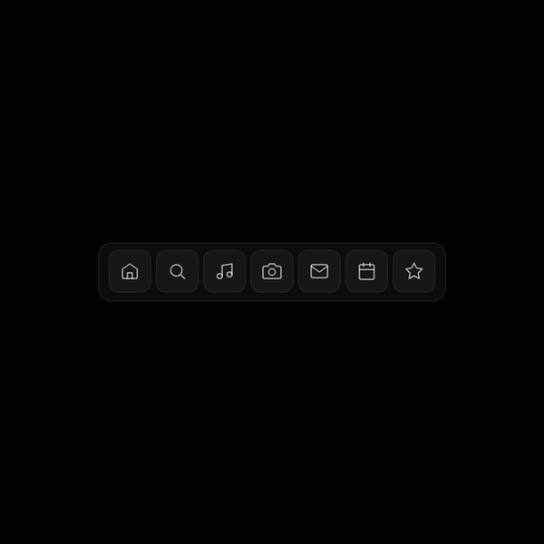

# Prism

<p align="center">
  <a href="https://prism.sammii.dev"></a>
</p>

<p align="center">
  <a href="https://prism.sammii.dev"></a>
  
  <a href="./LICENSE"></a>
</p>

**Cursor-reactive design engineering components.** Spring physics, zero runtime dependencies, one file per component. Every element responds chromatically to pointer position — components glow, borders shift, motion tracks where you are on the page.

→ **Live: [prism.sammii.dev](https://prism.sammii.dev)**

---

## What this is

A React component library where nothing is static. Move your cursor and colours shift across the viewport, borders pick up pastel tints from your pointer position, components lift and settle on spring curves. No CSS transitions, no framer-motion, no runtime dependencies at all — every motion system is hand-rolled with `requestAnimationFrame` and spring equations.

Every spring constant, glow and colour range is hand-written and tuned by eye.

## Why it's different

Every component library ships static components. Even "animated" ones use fixed colours and predefined motion. Prism components are alive — they respond to where you are on the page. Move your cursor left: blues and purples. Right: pinks and corals. Every interaction is uniquely coloured by where you triggered it, because a shared `usePointer` hook broadcasts position to every component simultaneously.

| Library     | Animated | Cursor-reactive      | Colour-mapped | Themeable palette |
|-------------|:--------:|:--------------------:|:-------------:|:-----------------:|
| shadcn/ui   | no       | no                   | no            | yes (CSS vars)    |
| Radix       | no       | no                   | no            | no                |
| Aceternity  | yes      | some                 | no            | no                |
| Magic UI    | yes      | no                   | no            | no                |
| React Bits  | yes      | some                 | no            | no                |
| **Prism**   | **yes**  | **every component**  | **yes**       | **yes**           |

## Shipped so far

26 components, three applied showcases and an interaction lab. Every demo is a live route on the site.

**Components** — [animated-border](https://prism.sammii.dev/animated-border), [async-button](https://prism.sammii.dev/async-button), [avatar](https://prism.sammii.dev/avatar), [command-palette](https://prism.sammii.dev/command-palette), [floating-dock](https://prism.sammii.dev/floating-dock), [focus-trail](https://prism.sammii.dev/focus-trail), [glow-badge](https://prism.sammii.dev/glow-badge), [glow-checkbox](https://prism.sammii.dev/glow-checkbox), [glow-input](https://prism.sammii.dev/glow-input), [glow-select](https://prism.sammii.dev/glow-select), [glow-slider](https://prism.sammii.dev/glow-slider), [glow-textarea](https://prism.sammii.dev/glow-textarea), [hover-reveal](https://prism.sammii.dev/hover-reveal), [icon-button](https://prism.sammii.dev/icon-button), [latency-adapt](https://prism.sammii.dev/latency-adapt), [morph-tabs](https://prism.sammii.dev/morph-tabs), [motion-compare](https://prism.sammii.dev/motion-compare), [progress-bar](https://prism.sammii.dev/progress-bar), [pulse-dot](https://prism.sammii.dev/pulse-dot), [radial-menu](https://prism.sammii.dev/radial-menu), [ripple-button](https://prism.sammii.dev/ripple-button), [skeleton](https://prism.sammii.dev/skeleton), [spotlight-card](https://prism.sammii.dev/spotlight-card), [spring-toggle](https://prism.sammii.dev/spring-toggle), [token-compose](https://prism.sammii.dev/token-compose), [tooltip](https://prism.sammii.dev/tooltip)

**Showcase** — [darkroom](https://prism.sammii.dev/showcase/darkroom), [release console](https://prism.sammii.dev/showcase/console), [synth](https://prism.sammii.dev/showcase/synth)

The fun-but-unusable experiments (magnetic button, fluid tooltip, shimmer text, tilt card and the canvas toys) moved to [chaos-components](https://github.com/Sammii-HK/chaos-components).

## The colour system

Position-mapped colour is the core primitive. A shared pointer hook broadcasts smoothed cursor coordinates, and every component samples colour from them through one of a small set of functions:

```ts
pastelColour(xPc, yPc, time)   // soft pastel RGB, floors at 140
cursorColour(xPc, yPc)         // vivid RGB
colourField(xPc, yPc, time)    // 4-blob ambient background gradient
colourBlend(xPc, yPc, opacity) // 3-circle vivid blend
usePointer({ lerp: 0.08 })     // smoothed cursor tracking hook
```

The range is currently the full spectrum. A `PrismProvider` with themeable palettes (ocean, sunset, neon, monochrome, custom) is on the roadmap — see [`COMPONENT-LIBRARY-PLAN.md`](./COMPONENT-LIBRARY-PLAN.md).

## Design principles

1. **Every component reacts to the cursor.** No static elements. Even subtle ones (badge, separator) have micro-reactions.
2. **Spring physics, not CSS transitions.** `requestAnimationFrame` + hand-rolled spring equations. Overshoot, settle, bounce.
3. **Zero runtime dependencies.** No framer-motion, no cmdk, no Radix. One file per component, each ~100–300 lines.
4. **Works without colour.** Every component is fully functional with the reactive colour disabled. Colour is an enhancement layer, not a dependency.
5. **Records well.** Every component must look striking in a 12-second square screen recording. If it doesn't hook the eye in three seconds, it isn't finished.
6. **Dark-first.** `#050505` background, luminous pastel accents. The colour is the decoration.

## Architecture

```
app/
  page.tsx                  Gallery index
  [slug]/page.tsx           Dynamic component route (explicit componentMap for Turbopack)
  atoms/page.tsx            All primitives rendered together
  lib/
    registry.ts             Component metadata
    primitives/
      gradient.ts           colourField, colourBlend, cursorColour, pastelColour
      cursor-glow.tsx       Lerp-smoothed cursor glow
      spotlight-card.tsx    Reactive pastel border card
    hooks/use-pointer.ts    Shared smoothed pointer hook
    components/<slug>.tsx   Each component, one file, named export + props interface
  demos/<slug>.tsx          Demo page per component
  showcase/<name>/          Applied demos built from the components
scripts/
  record.ts                 Playwright screen recorder
```

## Local dev

```bash
pnpm install
pnpm dev                    # http://localhost:3000
pnpm lint
pnpm build
```

Screen record any component:

```bash
npx tsx scripts/record.ts <slug> [duration_seconds]
# outputs to recordings/<slug>.mp4 — requires ffmpeg
```

## NPM package

`@sammii/prism-ui` is scaffolding. Distribution will be shadcn-style CLI (`npx @sammii/prism-ui add <component>`) with traditional imports as the secondary path. Tailwind v4 preset, ESM-only, `"sideEffects": false`, zero runtime deps. Copy-paste from the repo for now.

## Built by

**Sammii Kellow** — design engineer. London.

- Portfolio: [sammii.dev](https://sammii.dev)
- X: [@technicalyblond](https://x.com/technicalyblond)
- GitHub: [Sammii-HK](https://github.com/Sammii-HK)

## License

MIT. Copy, fork, remix.

## Install editable components

Eight components can be copied into a React 18+ / Tailwind CSS 4 project with the shadcn CLI. Their shared hooks and primitives are included under your configured UI directory in `prism/`. Current styles expect a dark surface.

```sh
npx shadcn@latest add https://prism.sammii.dev/r/prism-ai-response.json
```

See `/docs/installation` for setup, the full list and usage. The AI response item includes the stream adapter hook, without a provider, model call, credentials or demo recordings.

`npm run registry:build` rebuilds `/r/*.json` from the component sources. `npm run test:registry` detects stale payloads and compiles all installed files together outside the app, checking shared-file consistency and transitive imports.
